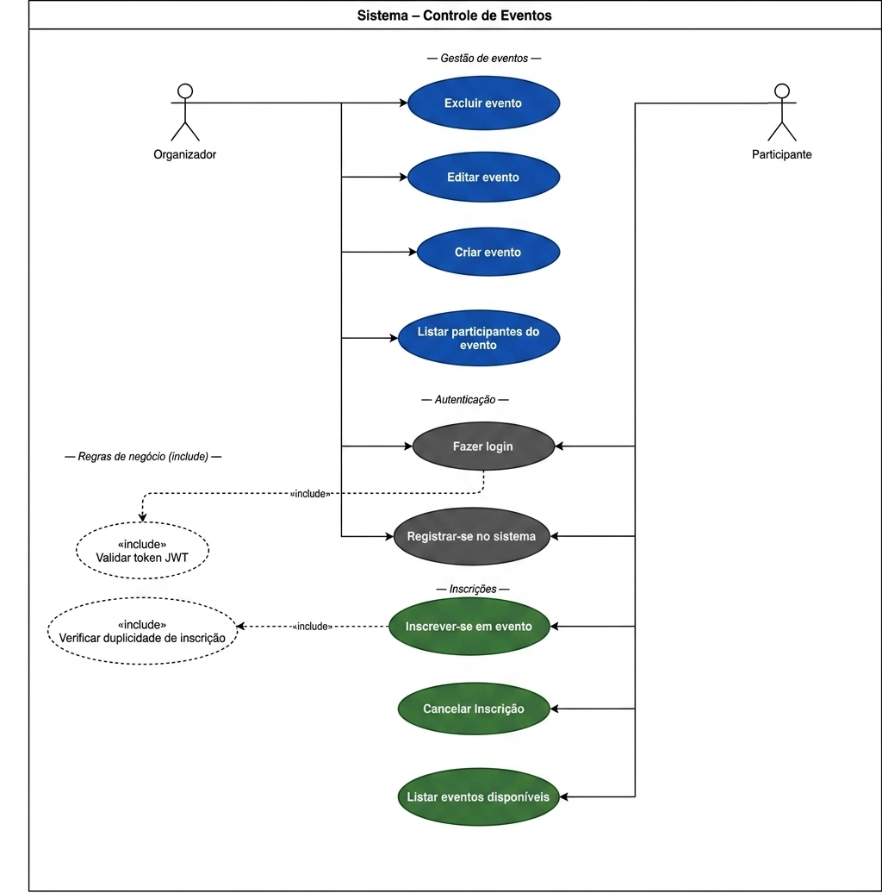
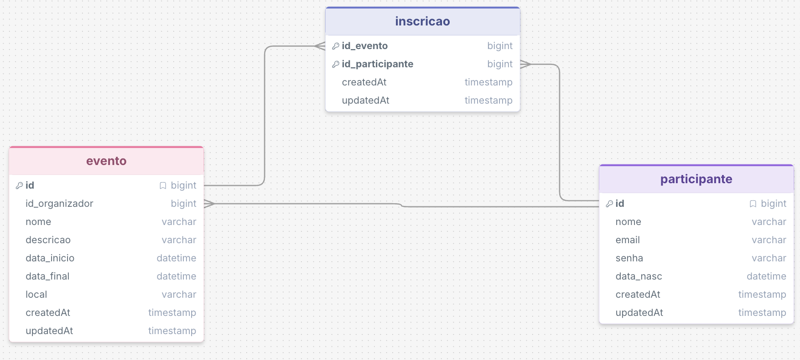

# API de Controle de Eventos

API REST desenvolvida em **AdonisJS 7 (TypeScript)** para gerenciamento de eventos: cadastro de participantes, criação de eventos, inscrição e cancelamento, com autenticação por token e persistência em **PostgreSQL**. Todo o ambiente roda com **Docker Compose** (API + banco), sem precisar instalar Node ou PostgreSQL na máquina.

> Trabalho da disciplina **Sistemas para Internet** (Prof. Igo Moura), atividade de **orquestração de múltiplos containers com Docker Compose**.

## Sumário

- [Início rápido (Docker)](#início-rápido-docker)
- [Arquitetura dos containers](#arquitetura-dos-containers)
- [Imagem no Docker Hub](#imagem-no-docker-hub)
- [Testando a API](#testando-a-api)
- [Teste de persistência (named volume)](#teste-de-persistência-named-volume)
- [Comandos úteis](#comandos-úteis)
- [Introdução e Escopo](#introdução-e-escopo)
- [Requisitos do Sistema](#requisitos-do-sistema)
- [Modelagem de Sistema e Dados](#modelagem-de-sistema-e-dados)
- [Arquitetura e Stack Tecnológica](#arquitetura-e-stack-tecnológica)
- [Rotas da API](#rotas-da-api)

---

## Início rápido (Docker)

### Pré-requisitos

- [Docker Desktop](https://www.docker.com/products/docker-desktop/) (Windows/macOS) ou Docker Engine + plugin Compose (Linux)
- Git

Confira com:

```bash
docker --version
docker compose version
```

### 1. Clonar o repositório

```bash
git clone https://github.com/SergioGuthyerres/Controle_de_Eventos-API.git
cd Controle_de_Eventos-API
```

### 2. Criar o arquivo `.env`

```bash
cp .env.example .env          # Windows (PowerShell): copy .env.example .env
```

Gere uma chave para a aplicação e cole no campo `APP_KEY=` do `.env`:

```bash
openssl rand -base64 32
# sem openssl (ex.: Windows):
docker run --rm node:24-alpine node -e "console.log(require('crypto').randomBytes(32).toString('base64'))"
```

Se quiser, troque também `DB_PASSWORD`.

### 3. Obter a imagem do Docker Hub (opcional, mas recomendado)

```bash
docker pull sergioguthyerres/controle-eventos-api:latest
```

> Se você pular este passo, o `docker compose up` constrói a imagem localmente a partir do `Dockerfile`.

### 4. Subir os serviços

```bash
docker compose up -d
docker compose ps        # aguarde os dois serviços ficarem "healthy"
```

### 5. Acessar

- API: <http://localhost:3333>
- Health check (API + banco): <http://localhost:3333/health>
- Lista de eventos: <http://localhost:3333/api/v1/eventos>

As tabelas são criadas automaticamente: ao iniciar, o container da API executa `node ace migration:run --force` antes de subir o servidor.

---

## Arquitetura dos containers

```
                    Host (seu computador)
   navegador / Insomnia / curl
              │  http://localhost:3333
              ▼  (port mapping 3333:3333)
 ┌──────────── rede "eventos-frontend" (bridge) ────────────┐
 │   ┌──────────────────────────┐                           │
 │   │ eventos-api  (AdonisJS)  │  usuário "node" (não-root)│
 │   └────────────┬─────────────┘                           │
 └────────────────┼─────────────────────────────────────────┘
 ┌────────────────┼──── rede "eventos-backend" (bridge, internal) ─┐
 │                │  DB_HOST=db  → DNS interno do Docker            │
 │   ┌────────────▼─────────────┐                                  │
 │   │ eventos-db (PostgreSQL)  │  SEM porta publicada no host     │
 │   └────────────┬─────────────┘                                  │
 └────────────────┼─────────────────────────────────────────────────┘
                  ▼
     volume nomeado "controle-eventos-pgdata"  →  /var/lib/postgresql/data
```

| Arquivo              | Função                                                                                                                                                                  |
| -------------------- | ----------------------------------------------------------------------------------------------------------------------------------------------------------------------- |
| `Dockerfile`         | Build **multi-stage** (deps → build → production) sobre `node:24-alpine`; imagem final só com JS compilado e dependências de produção; roda como usuário `node`; `HEALTHCHECK`. |
| `.dockerignore`      | Exclui `node_modules`, `build`, `.env`, `.git`, docs etc. do contexto de build (build mais rápido e sem segredos na imagem).                                                |
| `docker-compose.yml` | Orquestra `api` + `db`, redes `frontend`/`backend`, volume nomeado `pgdata`, healthchecks e `depends_on: service_healthy`.                                                |
| `.env.example`       | Modelo das variáveis de ambiente (credenciais do banco, `APP_KEY`, porta, usuário do Docker Hub).                                                                          |

**Decisões principais**

- **Variáveis de ambiente** para todos os dados sensíveis; o `.env` não é versionado nem copiado para a imagem.
- **Named volume** `pgdata` para os dados do PostgreSQL: `docker compose down` remove os containers, mas os dados ficam.
- **Rede `backend` interna** (`internal: true`): só a API enxerga o banco; o banco não tem porta exposta no host nem acesso à internet.
- **DNS interno**: a API se conecta em `DB_HOST=db`, o nome do serviço, e não em um IP fixo.
- **`depends_on` + `healthcheck`**: a API só inicia quando o Postgres já aceita conexões (`pg_isready`).

---

## Imagem no Docker Hub

Repositório: <https://hub.docker.com/r/sergioguthyerres/controle-eventos-api>

```bash
docker pull sergioguthyerres/controle-eventos-api:latest
```

Para publicar uma nova versão (mantenedores), gerando a imagem para Intel/AMD **e** Apple Silicon/ARM:

```bash
docker login
docker buildx build --platform linux/amd64,linux/arm64 \
  -t sergioguthyerres/controle-eventos-api:latest \
  -t sergioguthyerres/controle-eventos-api:1.0 \
  --push .
```

> Se o seu usuário no Docker Hub for outro, ajuste `DOCKERHUB_USER` no `.env`; o `docker-compose.yml` usa essa variável no nome da imagem.

---

## Testando a API

- **Navegador:** rotas `GET` públicas, por exemplo <http://localhost:3333/api/v1/eventos>.
- **VS Code:** abra `api-tests.http` com a extensão *REST Client*; o token é capturado automaticamente.
- **Insomnia/Postman ou curl** (macOS/Linux; no Windows use `curl.exe`):

```bash
# 1. Registrar participante (a resposta traz o token)
curl -X POST http://localhost:3333/api/v1/participantes \
  -H "Content-Type: application/json" \
  -d '{"nome":"Maria Silva","email":"maria@ifma.edu.br","senha":"segredo123","dataNasc":"2000-05-10"}'

# 2. Criar evento (substitua SEU_TOKEN)
curl -X POST http://localhost:3333/api/v1/eventos \
  -H "Authorization: Bearer SEU_TOKEN" -H "Content-Type: application/json" \
  -d '{"nome":"Semana de SI","descricao":"Palestras e minicursos","dataInicio":"2026-11-16","dataFinal":"2026-11-19","local":"IFMA"}'

# 3. Inscrever-se no evento 1
curl -X POST http://localhost:3333/api/v1/eventos/1/inscricoes -H "Authorization: Bearer SEU_TOKEN"

# 4. Listar eventos e inscritos
curl http://localhost:3333/api/v1/eventos
curl http://localhost:3333/api/v1/eventos/inscritos/1
```

---

## Teste de persistência (named volume)

```bash
# 1. Com dados cadastrados, derrube o ambiente (containers e redes são removidos)
docker compose down

# 2. O volume continua existindo
docker volume ls          # → controle-eventos-pgdata

# 3. Suba novamente e consulte: os dados continuam lá
docker compose up -d
curl http://localhost:3333/api/v1/eventos

# (opcional) consultar direto no banco
docker compose exec db psql -U eventos -d eventos -c "SELECT id, nome, local FROM eventos;"
```

> ⚠️ `docker compose down -v` **apaga** o volume e, com ele, todos os dados.

---

## Comandos úteis

| Comando                                   | O que faz                                              |
| ----------------------------------------- | ------------------------------------------------------ |
| `docker compose up -d`                    | Sobe os serviços em segundo plano                      |
| `docker compose up -d --build`            | Reconstrói a imagem da API e sobe                      |
| `docker compose ps`                       | Lista os serviços e o status (healthy/unhealthy)       |
| `docker compose logs -f api`              | Acompanha os logs da API                               |
| `docker compose exec db psql -U eventos -d eventos` | Abre o terminal do PostgreSQL                 |
| `docker compose down`                     | Remove containers e redes (**mantém** o volume)        |
| `docker compose down -v`                  | Remove também o volume (**apaga os dados**)            |
| `docker network inspect eventos-backend`  | Mostra a rede interna e quem está conectado            |
| `docker volume inspect controle-eventos-pgdata` | Mostra onde o volume fica no host                |

### Rodar sem Docker (desenvolvimento)

Requer Node.js 24+ e um PostgreSQL acessível. No `.env`, descomente o bloco "Somente para rodar SEM Docker" e então:

```bash
npm install
node ace migration:run
npm run dev
```

---

## Introdução e Escopo

### Objetivo do Projeto

Desenvolver uma API REST utilizando AdonisJS para gerenciamento de eventos, permitindo o cadastro de eventos, inscrição de participantes e controle de informações como data e local. A API segue padrões RESTful, com autenticação por token (Bearer) e persistência em PostgreSQL.

### Problema a Resolver

Organizadores de eventos frequentemente gerenciam inscrições de forma manual (planilhas, e-mails), o que gera duplicações, falta de controle de vagas e dificuldade de consulta de participantes. Este sistema centraliza e automatiza essas operações, garantindo integridade dos dados e acesso seguro via API.

### Público-Alvo

Desenvolvedores e equipes que precisam de um backend robusto para sistemas de eventos. Indiretamente, organizadores de eventos (que criam e gerenciam eventos) e participantes (que se inscrevem e consultam eventos).

---

## Requisitos do Sistema

### Requisitos Funcionais

| ID     | Funcionalidade / Descrição                                                                                                                                                                                                     | Prioridade |
| ------ | ------------------------------------------------------------------------------------------------------------------------------------------------------------------------------------------------------------------------------ | ---------- |
| RF-001 | **Autenticação de Participante** – O participante deve conseguir registrar-se e fazer login via e-mail e senha. Um token de acesso (Bearer) é emitido para autorizar as demais operações.                                                     | Alta       |
| RF-002 | **Cadastro de Eventos** – Organizadores autenticados podem criar, editar, listar e excluir eventos, informando nome, descrição, data/hora e local.                                                                             | Alta       |
| RF-003 | **Autenticação de Organizador / Inscrição em Eventos** – O organizador deve conseguir registrar-se e fazer login via e-mail e senha (token de acesso emitido); participantes autenticados podem se inscrever em eventos disponíveis. | Alta       |
| RF-004 | **Prevenção de Inscrições Duplicadas** – O sistema deve impedir que um mesmo participante se inscreva mais de uma vez no mesmo evento, retornando erro adequado.                                                               | Alta       |
| RF-006 | **Controle de Data e Local do Evento** – Cada evento possui data/hora de início e de encerramento, além de um campo de local (endereço ou descrição do local).                                                                 | Alta       |
| RF-007 | **Cancelamento de Inscrição** – Participantes podem cancelar sua inscrição em um evento, removendo o registro da tabela de inscrições.                                                                                         | Média      |

### Requisitos Não Funcionais

| ID      | Categoria        | Restrição / Descrição                                                                                                                                  |
| ------- | ---------------- | ------------------------------------------------------------------------------------------------------------------------------------------------------ |
| RNF-001 | Segurança        | Todas as rotas protegidas exigem token de acesso válido. Senhas são armazenadas com hash scrypt e nunca retornadas nas respostas. Comunicação via HTTPS em produção. |
| RNF-002 | Disponibilidade  | O sistema deve estar disponível 99% do tempo. Erros devem retornar respostas padronizadas com códigos HTTP apropriados e mensagens descritivas.        |
| RNF-003 | Manutenibilidade | O código deve seguir a estrutura de pastas e convenções do AdonisJS v7, com separação clara entre Controllers, Models, Migrations e Middlewares.       |
| RNF-004 | Portabilidade    | A aplicação deve ser executável via Docker, com variáveis de ambiente para configuração do banco, porta e chave da aplicação (APP_KEY).                                 |

---

## Modelagem de Sistema e Dados

### Diagrama de Casos de Uso

O sistema possui três atores principais: **Organizador**, **Participante** e **Sistema**.



**Casos de uso por ator:**

| Ator         | Casos de Uso                                                                                                  |
| ------------ | ------------------------------------------------------------------------------------------------------------- |
| Organizador  | Fazer login; Criar evento; Editar evento; Excluir evento; Gerenciar inscrições.                               |
| Participante | Fazer login; Registrar-se no sistema; Listar eventos disponíveis; Inscrever-se em evento; Cancelar inscrição. |
| Sistema      | Validar token de acesso; Verificar duplicidade de inscrição; Gerar timestamps automáticos.                          |

### Diagrama de Entidade-Relacionamento (DER)

**Entidades principais:**

- **participante** – Representa organizadores e participantes do sistema.
- **evento** – Representa os eventos cadastrados no sistema.
- **inscricao** – Tabela pivot que representa a inscrição de um participante em um evento (relacionamento N:N).

**Relacionamentos críticos:**

- Um Evento pode ter muitos Participantes (1:N via `inscricao`).
- Um Participante pode se inscrever em muitos Eventos (1:N via `inscricao`).
- Evento N:N Participantes – materializado pela entidade Inscrição (`inscricao`).
- Um Participante (organizador) pode criar muitos Eventos (1:N via `evento.id_organizador`).



### Dicionário de Dados

#### Tabela: `participantes`

| Atributo   | Tipo de Dado | Descrição / Restrições                        |
| ---------- | ------------ | --------------------------------------------- |
| id         | BIGINT       | Chave Primária (PK), Auto-incremento          |
| nome       | VARCHAR(255) | Nome completo do participante.                |
| email      | VARCHAR(255) | Obrigatório, Único. E-mail para autenticação. |
| senha      | VARCHAR(255) | Obrigatório. Hash scrypt da senha (nunca exposto na API). |
| data_nasc  | DATETIME     | Obrigatório. Verificar maioridade.            |
| created_at | TIMESTAMP    | Gerado automaticamente pelo AdonisJS.         |
| updated_at | TIMESTAMP    | Atualizado automaticamente pelo AdonisJS.     |

#### Tabela: `eventos`

| Atributo       | Tipo de Dado | Descrição / Restrições                              |
| -------------- | ------------ | --------------------------------------------------- |
| id             | BIGINT       | Chave Primária (PK), Auto-incremento                |
| nome           | VARCHAR(255) | Obrigatório. Nome do evento.                         |
| id_organizador | BIGINT       | Referência ao id do participante. NOT NULL.         |
| descricao      | TEXT         | Opcional. Descrição detalhada do evento.            |
| local          | VARCHAR(500) | Obrigatório. Endereço ou descrição do local.        |
| data_inicio    | TIMESTAMP    | Obrigatório. Data e hora de início do evento.       |
| data_final     | TIMESTAMP    | Obrigatório. Data e hora de encerramento do evento. |
| created_at     | TIMESTAMP    | Gerado automaticamente pelo AdonisJS.               |
| updated_at     | TIMESTAMP    | Atualizado automaticamente pelo AdonisJS.           |

#### Tabela: `inscricoes`

| Atributo        | Tipo de Dado | Descrição / Restrições                      |
| --------------- | ------------ | ------------------------------------------- |
| id              | BIGINT       | Chave Primária (PK), Auto-incremento.       |
| id_participante | BIGINT (FK)  | Referência ao id do participante. NOT NULL. |
| id_evento       | BIGINT (FK)  | Referência ao id do evento. NOT NULL.       |
| created_at      | TIMESTAMP    | Gerado automaticamente pelo AdonisJS.       |
| updated_at      | TIMESTAMP    | Atualizado automaticamente pelo AdonisJS.   |

> **Regra de unicidade:** O sistema realiza uma verificação na tabela `inscricoes`, consultando a combinação `(id_participante, id_evento)` antes de criar uma nova inscrição. Se essa combinação já existir, a operação é bloqueada e a API retorna um erro **400 (Bad Request)**, garantindo a regra de negócio de não permitir inscrições duplicadas.

---

## Arquitetura e Stack Tecnológica

A aplicação segue a arquitetura **MVC** proposta pelo AdonisJS, com camadas de roteamento, middleware, controllers, models e banco de dados. Por ser uma API REST (sem camada de View), as respostas são exclusivamente em JSON.

| Componente       | Detalhes                                                                          |
| ---------------- | --------------------------------------------------------------------------------- |
| Runtime          | Node.js 24 (imagem `node:24-alpine`)                                              |
| Framework        | AdonisJS v7 (TypeScript), com Lucid ORM integrado                                 |
| Banco de Dados   | PostgreSQL 16 (imagem `postgres:16-alpine`)                                       |
| ORM              | Lucid ORM: migrations, models e relacionamentos                                   |
| Autenticação     | `@adonisjs/auth`, guard de *access tokens* (token opaco `oat_...` no header Bearer) |
| Hash de senha    | `scrypt`, via `@adonisjs/core/hash`                                               |
| Validação        | VineJS                                                                            |
| Ambiente         | Docker + Docker Compose                                                           |
| Versionamento    | Git / GitHub                                                                      |

## Rotas da API

Prefixo: `/api/v1`. Rotas marcadas com 🔒 exigem `Authorization: Bearer <token>`.

| Método | Rota                              | Descrição                                      |
| ------ | --------------------------------- | ---------------------------------------------- |
| GET    | `/health` (sem prefixo)           | Status da API e da conexão com o banco         |
| POST   | `/participantes`                  | Registrar participante (retorna token)         |
| POST   | `/participantes/login`            | Login (retorna token)                          |
| GET    | `/participantes`                  | Listar participantes (id e nome)               |
| GET    | `/participantes/:id` 🔒           | Detalhe do próprio participante                |
| PUT    | `/participantes` 🔒               | Atualizar o participante logado                |
| DELETE | `/participantes` 🔒               | Excluir o participante logado                  |
| GET    | `/account/profile` 🔒             | Perfil do usuário logado                       |
| POST   | `/account/logout` 🔒              | Revogar o token atual                          |
| GET    | `/eventos`                        | Listar eventos                                 |
| GET    | `/eventos/:id`                    | Detalhe do evento                              |
| GET    | `/eventos/inscritos/:id`          | Participantes inscritos no evento              |
| POST   | `/eventos` 🔒                     | Criar evento (o usuário logado é o organizador) |
| PUT    | `/eventos/:id` 🔒                 | Editar evento (somente o organizador)          |
| DELETE | `/eventos/:id` 🔒                 | Excluir evento (somente o organizador)         |
| POST   | `/eventos/:id/inscricoes` 🔒      | Inscrever-se no evento (bloqueia duplicidade)  |
| GET    | `/inscricoes` 🔒                  | Minhas inscrições                              |
| GET    | `/inscricoes/:id` 🔒              | Detalhe de uma inscrição minha                 |
| DELETE | `/inscricoes/:id` 🔒              | Cancelar inscrição                             |

A coleção completa, com exemplos de corpo, está em [`api-tests.http`](api-tests.http).
